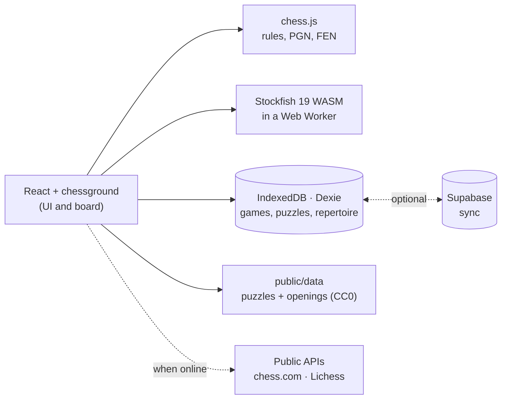

<div align="center">


# Open Chess

**Everything chess.com charges for when it comes to training, free and unlimited, on your own device.**

Play bots, review your games with Stockfish, solve puzzles, learn openings and endgames.<br/>
In the browser or as an Android app. No ads, no subscriptions, no account required.

[](LICENSE)


**[Try it in your browser](https://jupiutrera.github.io/open-chess/)** · **[Download the APK](https://github.com/jupiutrera/open-chess/releases/latest)**

[Español](README.md) · [Features](#features) · [How it works](#how-it-works) · [Getting started](#getting-started) · [Android APK](#android-apk)


</div>

## Why

On chess.com, full game review, unlimited puzzles, lessons and the opening trainer sit behind a paywall. But the engine doing the real work, Stockfish, is free software and already runs in any browser, and Lichess publishes its puzzles and openings into the public domain.

Open Chess puts those pieces together into an app with the chess.com experience you already know. Everything happens on your device: analysis, bots and your data. The one thing it doesn't do is play online against other people.

## Features

- **Game review**: every move is analysed by Stockfish and classified the chess.com way (brilliant, great, best, excellent, good, book, inaccuracy, mistake, miss, blunder). You also get:
  - Accuracy for each player (Lichess formula) and an estimated performance rating.
  - An evaluation graph with the key moments.
  - The best move, and the option to **retry** your mistakes on the board.
- **Play bots**: 13 opponents from **250 to 3200**, each with a personality and favourite openings. Play with or without a clock, with hints, takebacks, draw offers, an optional eval bar and premoves. There's also pass-and-play for two players on one device.
- **Puzzles**: **104,000** puzzles from the Lichess database:
  - Rated with **Glicko-2**.
  - **21 themes**.
  - Daily puzzle.
  - **Puzzle Rush**: 3 min, 5 min or survival, with personal bests.
- **Openings**: an explorer with **3,865 named openings**, masters and Lichess stats, name search, and a **repertoire trainer** that drills your lines with spaced repetition (SM-2).
- **Analysis board**: live multi-PV Stockfish, arrows, a position editor and FEN/PGN in and out.
- **Lessons**: tactics, basic mates, and endgames you practise **against the engine**.
- **Import** your games from **chess.com** or **Lichess** by username, or paste a PGN.
- Profile and stats, 5 boards, 9 piece sets, dark and light themes, Spanish and English.
- **Works offline**. Sync between web and phone through Supabase is **optional**, and JSON backups are available.

<div align="center">


</div>

## How it works



**Engine.** Stockfish 19 lite (single-threaded, 1.8 MB) runs in a Web Worker, so the UI never freezes. It works the same in the browser and inside Android's WebView, with no server. A small UCI client (`src/engine/engine.ts`) queues searches, cancels stale ones and converts scores to White's point of view.

**Move classification** (`src/features/review/classify.ts`). Each evaluation becomes a win probability using Lichess's curve, `win% = 50 + 50 · (2 / (1 + e^(-0.00368208 · cp)) − 1)`. A move is graded by how much win% the mover loses:

| Win% lost | Grade |
|---|---|
| engine's move, or < 0.5 | Best |
| < 2 | Excellent |
| < 5 | Good |
| < 10 | Inaccuracy |
| < 20 | Mistake |
| ≥ 20 | Blunder |

Special cases are layered on top:
- **Book**: the position is in the opening book.
- **Forced**: it was the only legal move.
- **Brilliant**: a real sacrifice that keeps a good position.
- **Great**: the only move that holds, more than 15 points ahead of the second best.
- **Miss**: the opponent blundered and you didn't punish it.

**Accuracy** follows Lichess: each player's volatility-weighted mean, averaged with their harmonic mean.

**Bots** (`src/features/play/bots.ts`). From 1400 up they use Stockfish's `UCI_Elo`. Stockfish won't go below 1320, so weaker bots run a shallow multi-PV search and sample a move through a temperature softmax, with an occasional random move. They make human-looking mistakes rather than broken ones.

**Puzzles.** `scripts/build-puzzles.mjs` streams the Lichess database (about 300 MB of zstd), keeps the popular puzzles and splits them into 100-point JSON buckets that load on demand. Your rating uses **Glicko-2**.

**Data** lives in IndexedDB. Every row carries `updatedAt` and a soft-delete flag, so syncing with Supabase is a plain last-write-wins: one table with per-user RLS and a server-side cursor. Without Supabase configured, nothing leaves your device.

## Getting started

You need Node 22 or later.

```bash
git clone <this-repo-url> open-chess
cd open-chess
npm install          # also copies Stockfish into public/stockfish
npm run dev          # http://localhost:5173
```

| Command | What it does |
|---|---|
| `npm run dev` | Dev server |
| `npm run build` | Production PWA build in `dist/` |
| `npm test` | Unit tests: classification, accuracy, Glicko, SM-2, lessons |
| `npm run e2e` | Playwright browser tests: a bot game and a full review |
| `npm run data:puzzles` | Rebuild puzzles from Lichess |
| `npm run data:openings` | Rebuild openings from lichess-org/chess-openings |
| `node scripts/build-pieces.mjs` | Download the piece sets |
| `node scripts/screenshots.mjs` | Regenerate the README screenshots |

## Android APK

You also need JDK 21 and the Android SDK.

```bash
npm run android                      # web build + Capacitor sync
cd android && ./gradlew assembleDebug
adb install -r app/build/outputs/apk/debug/app-debug.apk
```

For a signed release, create a keystore, set it up in `android/app/build.gradle` and run `./gradlew assembleRelease`.

## Optional setup

<details>
<summary><b>Cross-device sync (Supabase)</b></summary>

1. Create a free project at [supabase.com](https://supabase.com).
2. Run [`supabase/migrations/0001_records.sql`](supabase/migrations/0001_records.sql) in the SQL editor.
3. Under *Authentication*, enable Email (magic link) and optionally Google, then add the app URL to *Redirect URLs*.
4. Copy `.env.example` to `.env` and fill in `VITE_SUPABASE_URL` and `VITE_SUPABASE_ANON_KEY`.

</details>

<details>
<summary><b>Lichess explorer stats</b></summary>

The Lichess opening explorer API requires a personal token. Create one with no scopes at <https://lichess.org/account/oauth/token> and paste it into **Settings**. Without a token, the explorer still works from the local opening book.

</details>

## Contributing

Contributions are welcome: new lessons, more characterful bots, translations, classification tweaks… See [CONTRIBUTING.md](CONTRIBUTING.md).

## Credits and licences

Open Chess is **GPL-3.0-or-later**. It builds on:
- Stockfish and stockfish.js (GPL-3.0).
- chessground (GPL-3.0) and chess.js (BSD-2).
- Lichess puzzle and opening data (CC0).
- Piece sets from lichess-org/lila: Staunty, Fresca, Tatiana, Maestro, Cardinal and Gioco by sadsnake1, and California by Jerry S. (all CC BY-NC-SA 4.0); Chessnut (Apache-2.0); cburnett (GPL-2.0+).
- Microsoft Fluent Emoji (MIT), Phosphor icons (MIT) and the Geist font (OFL-1.1).

> [!NOTE]
> Several piece sets are licensed **non-commercial** (CC BY-NC-SA). Open Chess is and will stay free. If you fork it for commercial use, remove or replace those sets.

Open Chess is not affiliated with chess.com or Lichess.
