<div align="center">


# Open Chess

### Todo lo que chess.com cobra para entrenar, gratis y en tu dispositivo.

Revisión de partidas con Stockfish, 13 bots con personalidad, 14 retos, 104.000 puzzles, entrenador de aperturas y lecciones.<br/>
En el navegador o como app de Android. **Sin anuncios, sin suscripción y sin cuenta.**

[](https://github.com/jupiutrera/open-chess/releases/latest)
[](LICENSE)
[](https://github.com/jupiutrera/open-chess/stargazers)
[](https://jupiutrera.github.io/open-chess/)


<h3>
  <a href="https://jupiutrera.github.io/open-chess/">▶ Pruébala ahora</a> ·
  <a href="https://github.com/jupiutrera/open-chess/releases/latest">📱 Descarga el APK</a>
</h3>

[English](README.md) · [Funcionalidades](#-funcionalidades) · [Capturas](#-capturas) · [Cómo funciona](#-cómo-funciona) · [Empezar](#-empezar) · [Contribuir](#-contribuir)

<br/>

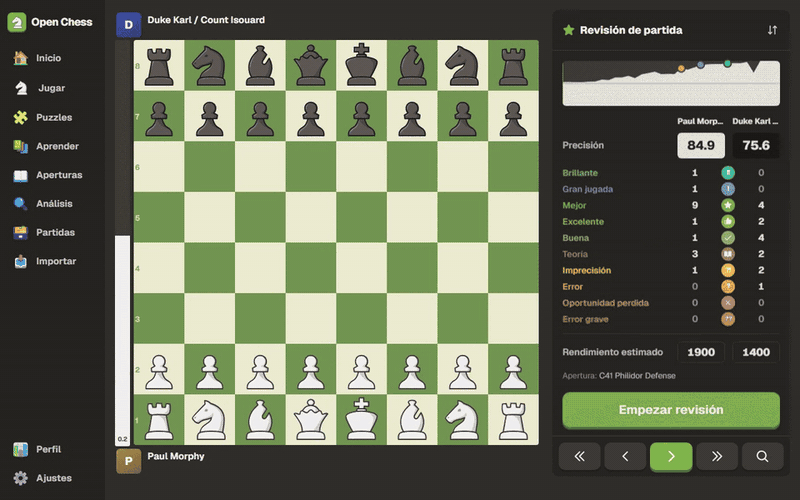

</div>

<br/>

<table align="center">
  <tr>
    <td align="center"><b>13 + 14</b><br/><sub>bots y retos</sub></td>
    <td align="center"><b>104.000</b><br/><sub>puzzles de Lichess</sub></td>
    <td align="center"><b>3.865</b><br/><sub>aperturas con nombre</sub></td>
    <td align="center"><b>11</b><br/><sub>lecciones interactivas</sub></td>
    <td align="center"><b>6</b><br/><sub>idiomas</sub></td>
    <td align="center"><b>0 €</b><br/><sub>para siempre</sub></td>
  </tr>
</table>

## 💡 Por qué existe

En chess.com, lo que de verdad te hace mejorar es de pago: revisar partidas sin límite, puzzles ilimitados, las lecciones y el entrenador de aperturas. Pero el motor que hace ese trabajo, **Stockfish**, es software libre y ya corre en cualquier navegador, y **Lichess** publica sus puzzles y aperturas como dominio público.

Open Chess junta esas piezas en una app con la experiencia de chess.com que ya conoces. Todo ocurre en tu dispositivo: el análisis, los bots y tus datos. Lo único que no hace es jugar online contra otras personas.

| | chess.com gratis | **Open Chess** |
|---|:---:|:---:|
| Revisión de partida completa (brillantes, errores, precisión…) | Limitada | ✅ **Ilimitada** |
| Puzzles y Puzzle Rush | Limitados | ✅ **104.000, sin límite** |
| Ayudas contra bots (evaluación, amenazas, sugerencias, motor) | Limitadas | ✅ **Todas** |
| Entrenador de repertorio | Premium | ✅ |
| Lecciones | Mayoría Premium | ✅ |
| Funciona sin conexión | ❌ | ✅ |
| Anuncios | Sí | ❌ **Nunca** |
| Tus datos | En sus servidores | ✅ **En tu dispositivo** |

<sub>Comparativa orientativa con el plan gratuito de chess.com; sus límites cambian con el tiempo.</sub>

## ✨ Funcionalidades

**🔍 Revisión de partidas.** Stockfish analiza cada jugada y la clasifica como chess.com: brillante, gran jugada, mejor, excelente, buena, teoría, imprecisión, error, oportunidad perdida y error grave. Ves la precisión de cada jugador, un rendimiento estimado y la gráfica de evaluación. Puedes ver la mejor jugada y **reintentar tus errores** para aprender de ellos.

**🤖 13 bots con personalidad.** Pip, el niño que acaba de descubrir el caballo; Iván, que sacrifica lo que haga falta; Boris, el maestro FIDE de la vieja escuela… Cada uno tiene avatar, aperturas favoritas y su propia forma de hablar: te saluda, reacciona a tus capturas y errores y celebra (o lamenta) el resultado. Juegan como personas, no como un motor roto.

**🐟 14 retos.** Stockfish, pero con una regla absurda: **Meltfish** pierde 50 de Elo por jugada, **Growfish** empieza en 0 y va subiendo, **Envyfish** baja 300 cada vez que encuentras la mejor jugada, **Drawfish** juega a por el 0.00, **Checkfish** da jaque siempre que puede, **Greedfish** se lo come todo, **Coinfish** elige su n-ésima mejor jugada con probabilidad ½ⁿ, **Yoyofish** salta entre 250 y 3200 en cada captura, **Copyfish** copia la calidad de tu última jugada… El Elo del bot cambia en directo mientras juegas.

**🎯 Cinco ayudas opcionales.** Barra de evaluación, flechas de amenaza, flechas de sugerencia, valoración de cada jugada en directo y líneas del motor. Actívalas antes o durante la partida.

**🧩 Puzzles.** 104.000 puzzles de Lichess con puntuación Glicko-2, 47 temas, puzzle del día, **Puzzle Rush** (3 min, 5 min y supervivencia), **Racha de problemas** (sin reloj, cada vez más difíciles, un fallo y se acaba) y **puzzles de tus errores**, sacados de tus propias partidas revisadas.

**📖 Aperturas.** Explorador con 3.865 aperturas con nombre, estadísticas de maestros y Lichess, y un **entrenador de repertorio** con repetición espaciada (SM-2).

**🧠 Análisis.** Stockfish en directo con hasta tres líneas, valoración de cada jugada, editor de posición y carga y copia de FEN y PGN.

**🎓 Lecciones.** Táctica, mates básicos y finales, que practicas contra el motor hasta que te salen.

**📥 Importa tus partidas** de chess.com o Lichess con tu nombre de usuario, o pegando un PGN.

**🎨 A tu gusto.** 9 juegos de piezas, 5 tableros, tema claro, oscuro o el del sistema, 5 juegos de sonidos grabados, flechas de caballo en L y vibración en Android.

**🌍 En tu idioma.** Español, English, Français, Italiano, 中文 y 日本語, incluidos las lecciones y lo que dicen los bots.

## 📸 Capturas

<div align="center">
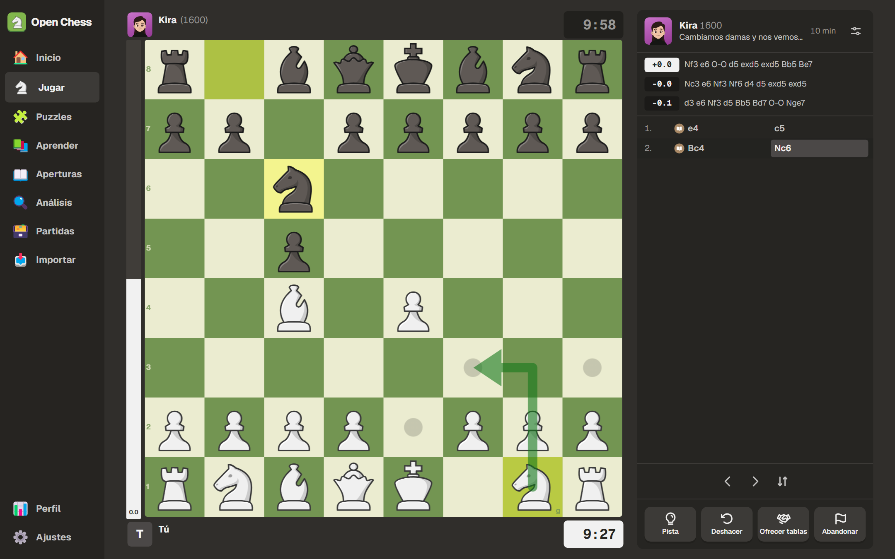
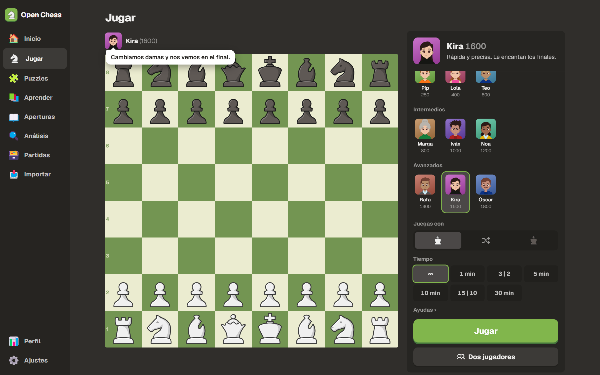
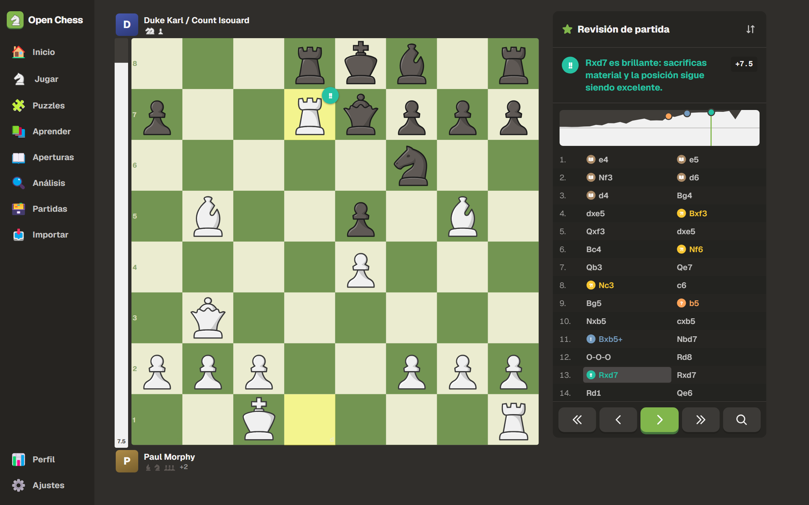
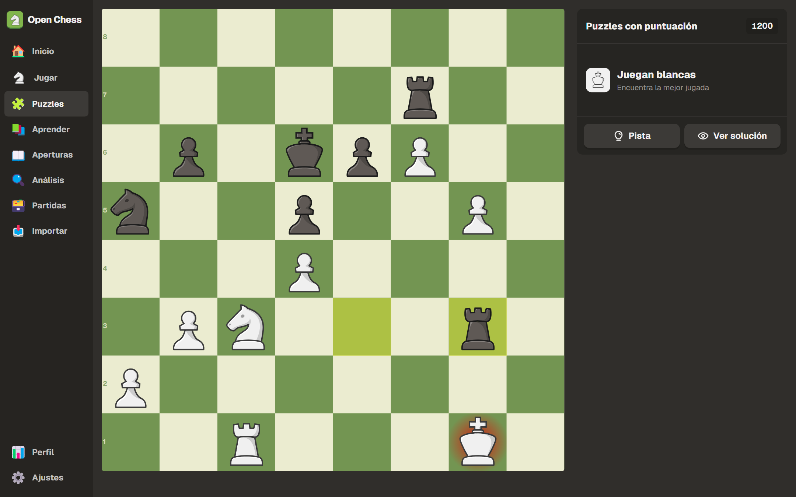
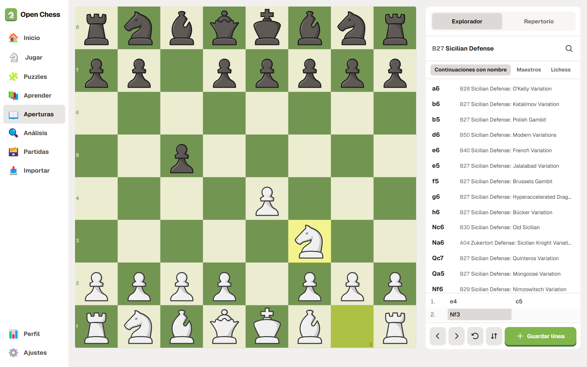
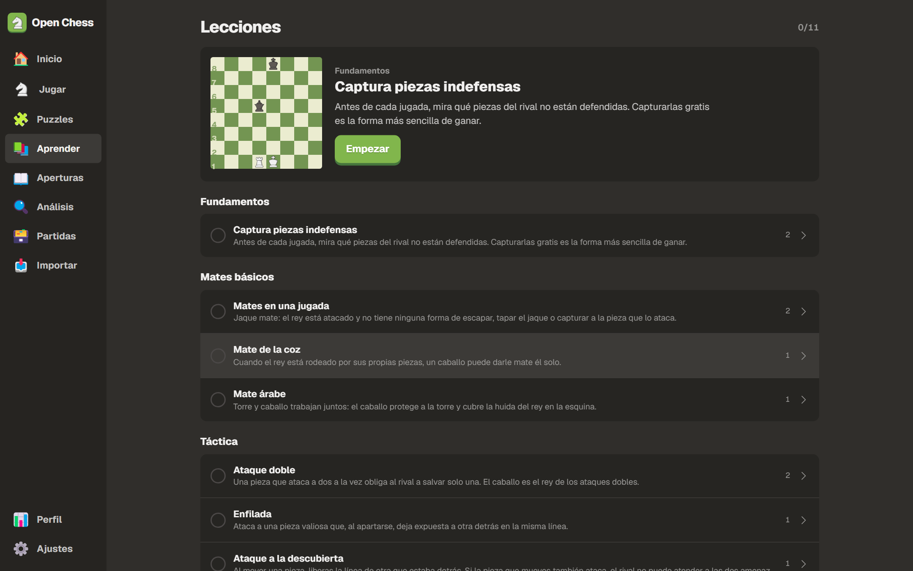
<br/>
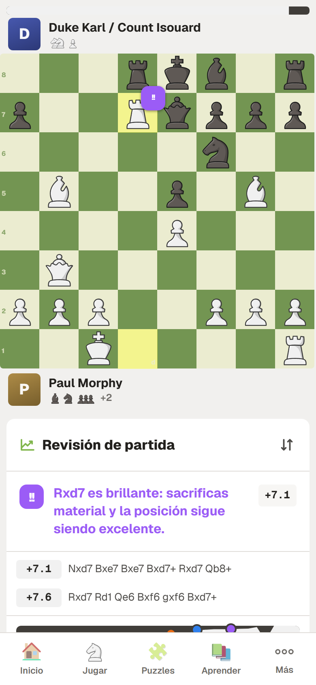
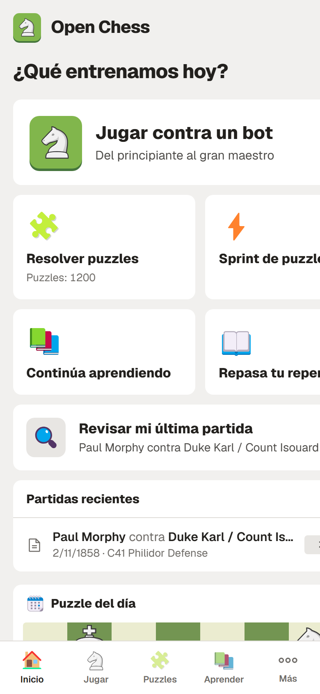
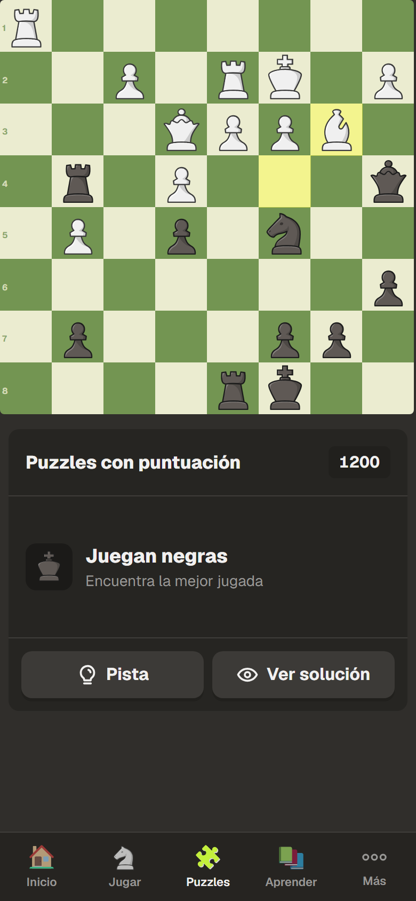
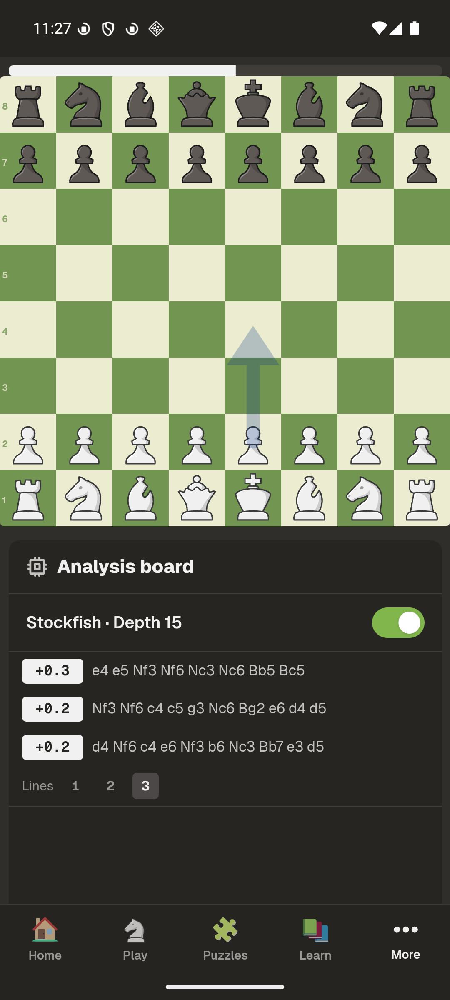
</div>

## ⚙️ Cómo funciona

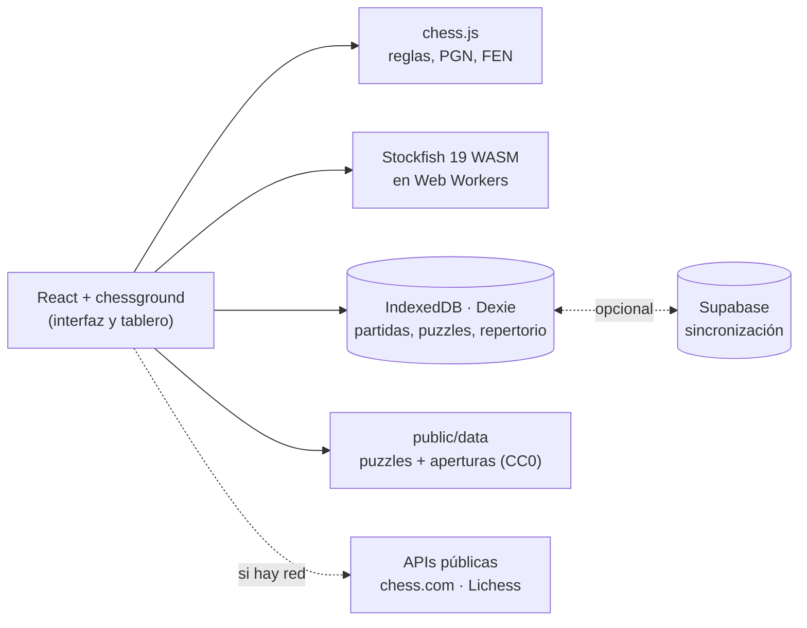

<details>
<summary><b>El motor</b></summary>

Stockfish 19 (versión *lite*, de un hilo y 1,8 MB) se ejecuta en un Web Worker, así que la interfaz nunca se bloquea. Funciona igual en el navegador y dentro del WebView de Android, sin servidor. Un cliente UCI pequeño (`src/engine/engine.ts`) pone en cola las búsquedas, cancela las que ya no sirven y convierte la evaluación al punto de vista de las blancas. Las ayudas de las partidas usan su propio worker con caché por posición, así que nunca frenan al bot.

</details>

<details>
<summary><b>La clasificación de jugadas</b></summary>

La evaluación de cada posición se convierte en probabilidad de victoria con la curva de Lichess:

```
win% = 50 + 50 · (2 / (1 + e^(-0.00368208 · cp)) − 1)
```

La calidad de una jugada depende de cuánta probabilidad de victoria pierde quien mueve:

| Pérdida de win% | Clasificación |
|---|---|
| es la jugada del motor o pierde < 0,5 | Mejor |
| < 2 | Excelente |
| < 5 | Buena |
| < 10 | Imprecisión |
| < 20 | Error |
| ≥ 20 | Error grave |

Además se detectan casos especiales: **teoría** (la posición está en el libro), **forzada** (solo había una jugada legal), **brillante** (sacrificas material y la posición sigue siendo buena), **gran jugada** (la única que mantiene la ventaja) y **oportunidad perdida** (el rival se equivocó y no lo aprovechaste). La **precisión** usa la fórmula de Lichess. Todo está en `src/features/review/classify.ts`.

</details>

<details>
<summary><b>Los bots</b></summary>

Desde 1400 de ELO se usa el `UCI_Elo` de Stockfish. Por debajo, Stockfish no baja de 1320, así que los bots débiles buscan a poca profundidad varias candidatas y eligen una con una *softmax* con temperatura y algo de azar. Así se equivocan como una persona. Cada bot tiene aperturas favoritas, un estilo de conversación y un avatar cuya expresión cambia según vaya la partida (`src/features/play/`).

</details>

<details>
<summary><b>Puzzles, datos y sincronización</b></summary>

`scripts/build-puzzles.mjs` descarga en streaming la base de datos de Lichess (unos 300 MB en zstd), se queda con los puzzles populares y los reparte en archivos por tramos de 100 puntos que se cargan bajo demanda. La app guarda sin conexión el libro de aperturas desde el principio, y cada tramo de puzzles (junto con los dos vecinos) en cuanto lo usas, así que sin red tienes los puzzles de tu nivel. Tu puntuación usa **Glicko-2**.

Tus datos viven en IndexedDB. Cada fila lleva `updatedAt` y borrado lógico, así que la sincronización opcional con Supabase es un *last-write-wins* sencillo con RLS por usuario: el servidor ignora cualquier escritura más antigua que la que ya tiene, y los cambios se descargan siguiendo una secuencia del servidor. Gana la hora de modificación del dispositivo, así que un reloj muy desajustado puede hacer que gane el cambio equivocado. Si no configuras Supabase, no se envía nada a ningún sitio.

</details>

## 🚀 Empezar

Necesitas Node 22 o superior.

```bash
git clone https://github.com/jupiutrera/open-chess.git
cd open-chess
npm install          # también copia Stockfish a public/stockfish
npm run dev          # http://localhost:5173
```

| Comando | Qué hace |
|---|---|
| `npm run dev` | Servidor de desarrollo |
| `npm run build` | Build de producción (PWA) en `dist/` |
| `npm test` | Tests unitarios: clasificación, precisión, Glicko, lecciones, traducciones |
| `npm run e2e` | Tests en navegador con Playwright |
| `npm run data:puzzles` | Regenera los puzzles desde Lichess |
| `npm run data:openings` | Regenera las aperturas desde lichess-org/chess-openings |
| `npm run data:avatars` | Genera los avatares de los bots |
| `npm run data:sounds` | Descarga y convierte los juegos de sonidos (necesita ffmpeg) |
| `node scripts/screenshots.mjs --gif` | Regenera las capturas y el GIF de este README |

<details>
<summary><b>📱 APK de Android</b></summary>

También hacen falta JDK 21 y el Android SDK.

```bash
npm run android                      # build web + sincroniza con el proyecto Android
cd android && ./gradlew assembleDebug
adb install -r app/build/outputs/apk/debug/app-debug.apk
```

Para una versión firmada, crea una keystore y apunta a ella desde `android/keystore.properties` (está en `.gitignore`):

```properties
storeFile=/ruta/a/open-chess.jks
storePassword=…
keyAlias=open-chess
keyPassword=…
```

y ejecuta `./gradlew assembleRelease`. Guarda una copia de la keystore: si la pierdes, nadie podrá actualizar la app instalada. Al subir un tag `v*`, el workflow `android-release.yml` compila el APK firmado y lo adjunta a la release; para eso necesita los secretos `ANDROID_KEYSTORE_BASE64`, `ANDROID_KEYSTORE_PASSWORD`, `ANDROID_KEY_ALIAS` y `ANDROID_KEY_PASSWORD`.

</details>

<details>
<summary><b>🔄 Sincronización entre dispositivos (Supabase)</b></summary>

1. Crea un proyecto gratuito en [supabase.com](https://supabase.com).
2. Ejecuta en orden las migraciones de [`supabase/migrations/`](supabase/migrations/) en el editor SQL. Si ya usabas la sincronización, ejecuta solo las nuevas.
3. En *Authentication*, activa Email (magic link) y, si quieres, Google. Añade la URL de la app en *Redirect URLs*.
4. Copia `.env.example` a `.env` y rellena `VITE_SUPABASE_URL` y `VITE_SUPABASE_ANON_KEY`.

</details>

<details>
<summary><b>📊 Estadísticas del explorador de Lichess</b></summary>

La API del explorador de aperturas de Lichess pide un token personal. Créalo sin ningún permiso en <https://lichess.org/account/oauth/token> y pégalo en **Ajustes**. Sin token, el explorador sigue funcionando con el libro de aperturas local.

</details>

<details>
<summary><b>🗂️ Estructura del código</b></summary>

```
src/
  engine/      cliente UCI de Stockfish
  chess/       utilidades, sonidos, reloj, estado de partida
  board/       tablero, barra de evaluación, lista de jugadas, marcas de resultado
  features/
    play/      bots, avatares, conversación, ayudas, partidas
    review/    análisis, clasificación, precisión, revisión
    puzzles/   datos, Glicko-2, puzzles, Rush
    openings/  libro, explorador, repertorio (SM-2)
    lessons/   lecciones y reproductor
    analysis/  tablero de análisis y editor
    import/    chess.com, Lichess, PGN
    profile/   perfil, partidas, ajustes
  db/          Dexie (IndexedDB)
  sync/        Supabase y copias de seguridad
  i18n/        6 idiomas + traducciones de lecciones y bots
android/       proyecto Capacitor
scripts/       generación de datos, avatares, sonidos y capturas
```

</details>

## 🤝 Contribuir

Las contribuciones son bienvenidas: nuevas lecciones, más bots, **traducciones a otros idiomas**, mejoras de la clasificación… Lee [CONTRIBUTING.md](CONTRIBUTING.md) antes de abrir un PR.

- Las lecciones son datos en `src/features/lessons/lessonData.ts`, y un test comprueba que todas sus jugadas son legales.
- Para añadir un idioma, copia `src/i18n/en.json` y `src/i18n/content/fr.json` y regístralo como explica CONTRIBUTING. Un test comprueba que no falte ninguna clave.

## 📜 Créditos y licencias

Open Chess se distribuye bajo **GPL-3.0-or-later** y se apoya en:

| Recurso | Autor | Licencia |
|---|---|---|
| [Stockfish](https://stockfishchess.org) / [stockfish.js](https://github.com/nmrugg/stockfish.js) | Equipo de Stockfish, Nathan Rugg | GPL-3.0 |
| [chessground](https://github.com/lichess-org/chessground) | Lichess | GPL-3.0 |
| [chess.js](https://github.com/jhlywa/chess.js) | Jeff Hlywa | BSD-2 |
| [Base de datos de puzzles](https://database.lichess.org/#puzzles) y [chess-openings](https://github.com/lichess-org/chess-openings) | Lichess | CC0 |
| Piezas Staunty, Fresca, Tatiana, Maestro, Cardinal, Gioco | sadsnake1 | CC BY-NC-SA 4.0 |
| Piezas California | Jerry S. | CC BY-NC-SA 4.0 |
| Piezas Chessnut | Alexis Luengas | Apache-2.0 |
| Piezas cburnett | Colin M.L. Burnett | GPL-2.0+ |
| Avatares de los bots, estilo [Open Peeps](https://www.dicebear.com/styles/open-peeps/) vía [DiceBear](https://www.dicebear.com) | Pablo Stanley | CC0 1.0 |
| Avatar de Stockfish, estilo [Bottts](https://www.dicebear.com/styles/bottts/) | Pablo Stanley | Libre para uso personal y comercial |
| Sonidos «Madera» | [pychess](https://github.com/pychess/pychess) | GPL-3.0 |
| Sonidos SFX, Piano, NES y Futurista | Enigmahack, vía [Lichess](https://github.com/lichess-org/lila) | AGPL-3.0+ |
| Iconos [Fluent Emoji](https://github.com/microsoft/fluentui-emoji) | Microsoft | MIT |
| Iconos [Phosphor](https://phosphoricons.com) | Phosphor | MIT |
| Fuente [Geist](https://vercel.com/font) | Vercel | OFL-1.1 |

> [!NOTE]
> Varios juegos de piezas tienen licencia **no comercial** (CC BY-NC-SA). Open Chess es y será gratuito. Si haces un fork con fines comerciales, quita esos juegos o sustitúyelos por otros.

Open Chess no tiene ninguna relación con chess.com ni con Lichess.

<div align="center">
<br/>

**Si Open Chess te ahorra una suscripción, dale una ⭐ al repo.**<br/>
<sub>Así llega a más gente que quiere entrenar sin pagar.</sub>

</div>
