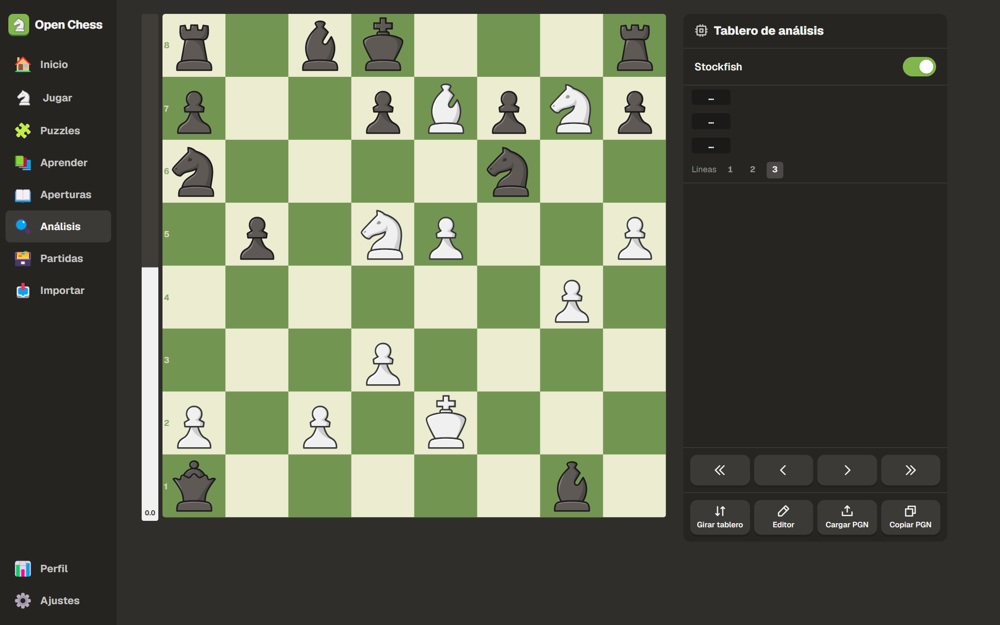
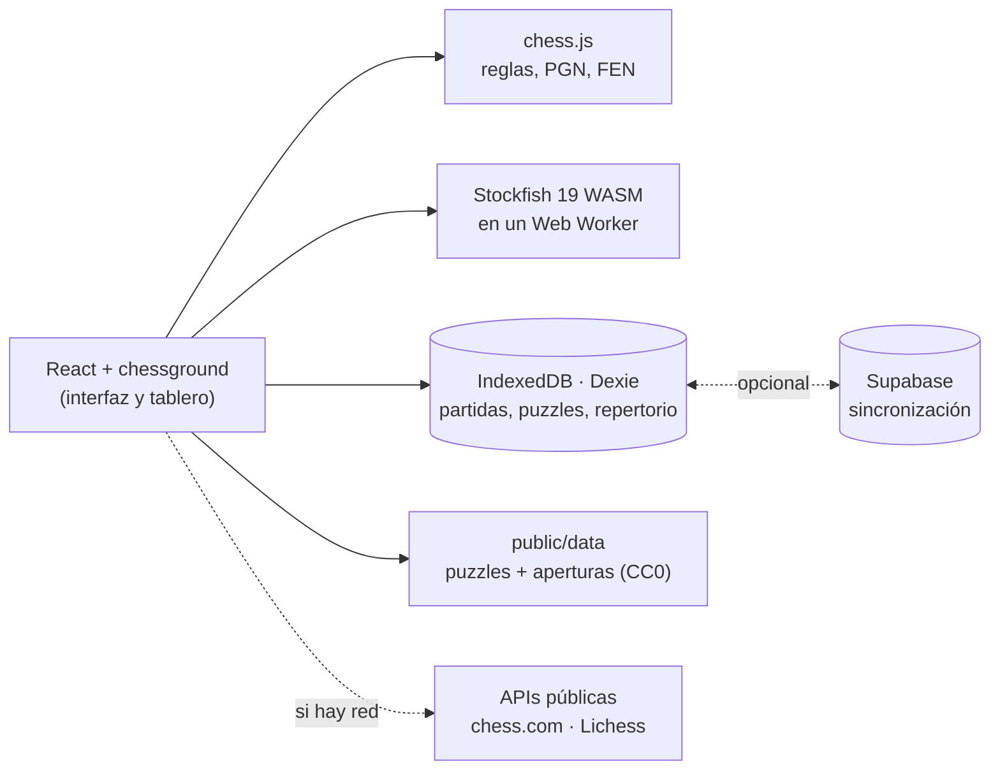

<div align="center">


# Open Chess

**Todo lo bueno de chess.com para entrenar, gratis, sin límites y en tu propio dispositivo.**

Juega contra bots, revisa tus partidas con Stockfish, resuelve puzzles, aprende aperturas y finales.<br/>
En el navegador o como app de Android. Sin anuncios, sin suscripciones y sin cuenta obligatoria.

[](LICENSE)


**[Pruébala en el navegador](https://jupiutrera.github.io/open-chess/)** · **[Descarga el APK](https://github.com/jupiutrera/open-chess/releases/latest)**

[English](README.en.md) · [Funcionalidades](#funcionalidades) · [Cómo funciona](#cómo-funciona) · [Empezar](#empezar) · [APK de Android](#apk-de-android)


</div>

## Por qué

En chess.com, la revisión completa de partidas, los puzzles ilimitados, las lecciones y el entrenador de aperturas son de pago. Pero el motor que hace el trabajo de verdad, Stockfish, es software libre y ya corre en cualquier navegador. Lichess publica sus puzzles y sus aperturas como dominio público.

Open Chess junta esas piezas en una app con la experiencia de chess.com que ya conoces. Todo ocurre en tu dispositivo: el análisis, los bots y tus datos. Lo único que no hace es jugar online contra otras personas.

## Funcionalidades

- **Revisión de partidas**: Stockfish analiza cada jugada y la clasifica como chess.com (brillante, gran jugada, mejor, excelente, buena, teoría, imprecisión, error, oportunidad perdida y error grave). Muestra la precisión de cada jugador, un rendimiento estimado, la gráfica de evaluación, la mejor jugada y te deja **reintentar** tus errores.
- **Jugar contra bots**: 13 rivales con personalidad, de **250 a 3200** de ELO. Puedes jugar con reloj, pistas, deshacer, tablas y barra de evaluación, y también hay modo de dos jugadores en el mismo dispositivo.
- **Puzzles**: **104.000** puzzles de Lichess con puntuación Glicko-2, 21 temas, puzzle del día y **Puzzle Rush** (3 min, 5 min y supervivencia).
- **Aperturas**: explorador con 3.865 aperturas con nombre y **entrenador de repertorio** con repetición espaciada.
- **Análisis**: Stockfish en vivo con varias líneas, editor de posición y FEN y PGN.
- **Lecciones**: táctica, mates básicos y finales que practicas contra el motor.
- **Importar** tus partidas de chess.com o Lichess con tu nombre de usuario, o pegando un PGN.
- Perfil con estadísticas, 9 juegos de piezas, 5 tableros, tema claro y oscuro, español e inglés, y funciona **sin conexión**.

<div align="center">





</div>

## Cómo funciona



**El motor.** Stockfish 19 (versión *lite*, de un solo hilo y 1,8 MB) se ejecuta en un Web Worker, así que la interfaz nunca se bloquea. Funciona igual en el navegador y dentro del WebView de Android, sin servidor. Un cliente UCI pequeño (`src/engine/engine.ts`) pone en cola las búsquedas, cancela las que ya no sirven y convierte la evaluación al punto de vista de las blancas.

**La clasificación de jugadas** (`src/features/review/classify.ts`). La evaluación de cada posición se convierte en probabilidad de victoria con la curva de Lichess:

```
win% = 50 + 50 · (2 / (1 + e^(-0.00368208 · cp)) − 1)
```

La calidad de una jugada depende de cuánta probabilidad de victoria pierde quien mueve:

| Pérdida de win% | Clasificación |
|---|---|
| es la jugada del motor o pierde < 0,5 | Mejor |
| < 2 | Excelente |
| < 5 | Buena |
| < 10 | Imprecisión |
| < 20 | Error |
| ≥ 20 | Error grave |

Además se detectan casos especiales:
- **Teoría**: la posición está en el libro de aperturas.
- **Forzada**: solo había una jugada legal.
- **Brillante**: sacrificas material y la posición sigue siendo buena.
- **Gran jugada**: la única que mantiene la ventaja, con más de 15 puntos sobre la segunda mejor.
- **Oportunidad perdida**: el rival se equivocó y no lo aprovechaste.

La **precisión** usa la fórmula de Lichess: la media de cada jugador, ponderada por la volatilidad de la partida, se promedia con su media armónica.

**Los bots** (`src/features/play/bots.ts`). Desde 1400 de ELO se usa el `UCI_Elo` de Stockfish. Por debajo, Stockfish no baja de 1320, así que los bots débiles buscan a poca profundidad varias jugadas candidatas y eligen una con una función *softmax*, con algo de temperatura y una probabilidad de hacer una jugada al azar. Así se equivocan como lo haría una persona, no como un motor roto. Cada bot tiene además sus aperturas favoritas.

**Los puzzles** se generan con `scripts/build-puzzles.mjs`, que descarga en streaming la base de datos de Lichess (unos 300 MB en zstd), se queda con los puzzles populares y los reparte en archivos JSON por tramos de 100 puntos que se cargan bajo demanda. Tu puntuación se calcula con **Glicko-2**.

**Tus datos** viven en IndexedDB. Cada fila lleva `updatedAt` y un borrado lógico, de modo que la sincronización con Supabase es un *last-write-wins* sencillo: una única tabla con RLS por usuario y un cursor de servidor. Si no configuras Supabase, no se envía nada a ningún sitio.

## Empezar

Necesitas Node 22 o superior.

```bash
git clone <url-de-este-repo> open-chess
cd open-chess
npm install          # también copia Stockfish a public/stockfish
npm run dev          # http://localhost:5173
```

| Comando | Qué hace |
|---|---|
| `npm run dev` | Servidor de desarrollo |
| `npm run build` | Build de producción (PWA) en `dist/` |
| `npm test` | Tests unitarios: clasificación, precisión, Glicko, lecciones |
| `npm run e2e` | Tests en navegador con Playwright: partida contra un bot y revisión completa |
| `npm run data:puzzles` | Regenera los puzzles desde Lichess |
| `npm run data:openings` | Regenera las aperturas desde lichess-org/chess-openings |
| `node scripts/build-pieces.mjs` | Descarga los juegos de piezas |
| `node scripts/screenshots.mjs` | Regenera las capturas de este README |

## APK de Android

Para Android también hacen falta JDK 21 y el Android SDK.

```bash
npm run android                      # build web + sincroniza con el proyecto Android
cd android && ./gradlew assembleDebug
adb install -r app/build/outputs/apk/debug/app-debug.apk
```

Para publicar una versión firmada, crea un keystore, configúralo en `android/app/build.gradle` y ejecuta `./gradlew assembleRelease`.

## Configuración opcional

<details>
<summary><b>Sincronización entre dispositivos (Supabase)</b></summary>

1. Crea un proyecto gratuito en [supabase.com](https://supabase.com).
2. Ejecuta [`supabase/migrations/0001_records.sql`](supabase/migrations/0001_records.sql) en el editor SQL.
3. En *Authentication*, activa Email (magic link) y, si quieres, Google. Añade la URL de la app en *Redirect URLs*.
4. Copia `.env.example` a `.env` y rellena `VITE_SUPABASE_URL` y `VITE_SUPABASE_ANON_KEY`.

</details>

<details>
<summary><b>Estadísticas del explorador de Lichess</b></summary>

La API del explorador de aperturas de Lichess pide un token personal. Créalo sin ningún permiso en <https://lichess.org/account/oauth/token> y pégalo en **Ajustes**. Sin token, el explorador sigue funcionando con el libro de aperturas local.

</details>

## Estructura

```
src/
  engine/      cliente UCI de Stockfish
  chess/       utilidades, sonidos sintetizados, reloj, estado de partida
  board/       tablero, barra de evaluación, lista de jugadas, barras de jugador
  features/
    play/      bots, partida contra bot, dos jugadores
    review/    análisis, clasificación, precisión, interfaz de revisión
    puzzles/   datos, Glicko-2, puzzles, Rush
    openings/  libro, explorador, repertorio (SM-2)
    lessons/   lecciones y reproductor
    analysis/  tablero de análisis y editor
    import/    chess.com, Lichess, PGN
    profile/   perfil, partidas, ajustes
  db/          Dexie (IndexedDB)
  sync/        Supabase y copias de seguridad
  i18n/        es.json, en.json
android/       proyecto Capacitor
scripts/       generación de datos, piezas y capturas
```

## Contribuir

Las contribuciones son bienvenidas: nuevas lecciones, bots con más personalidad, traducciones, mejoras de la clasificación… Lee [CONTRIBUTING.md](CONTRIBUTING.md) antes de abrir un PR. Las lecciones son datos en `src/features/lessons/lessonData.ts`, y un test comprueba que todas sus jugadas son legales.

## Créditos y licencias

Open Chess se distribuye bajo **GPL-3.0-or-later** y se apoya en:

| Recurso | Autor | Licencia |
|---|---|---|
| [Stockfish](https://stockfishchess.org) / [stockfish.js](https://github.com/nmrugg/stockfish.js) | Equipo de Stockfish, Nathan Rugg | GPL-3.0 |
| [chessground](https://github.com/lichess-org/chessground) | Lichess | GPL-3.0 |
| [chess.js](https://github.com/jhlywa/chess.js) | Jeff Hlywa | BSD-2 |
| [Base de datos de puzzles](https://database.lichess.org/#puzzles) y [chess-openings](https://github.com/lichess-org/chess-openings) | Lichess | CC0 |
| Piezas Staunty, Fresca, Tatiana, Maestro, Cardinal, Gioco | sadsnake1 | CC BY-NC-SA 4.0 |
| Piezas California | Jerry S. | CC BY-NC-SA 4.0 |
| Piezas Chessnut | Alexis Luengas | Apache-2.0 |
| Piezas cburnett | Colin M.L. Burnett | GPL-2.0+ |
| Iconos [Fluent Emoji](https://github.com/microsoft/fluentui-emoji) | Microsoft | MIT |
| Iconos [Phosphor](https://phosphoricons.com) | Phosphor | MIT |
| Fuente [Geist](https://vercel.com/font) | Vercel | OFL-1.1 |

> [!NOTE]
> Varios juegos de piezas tienen licencia **no comercial** (CC BY-NC-SA). Open Chess es y será gratuito. Si haces un fork con fines comerciales, quita esos juegos o sustitúyelos por otros.

Open Chess no tiene ninguna relación con chess.com ni con Lichess. Es un proyecto hecho por gente que quiere seguir entrenando sin pagar una suscripción.
