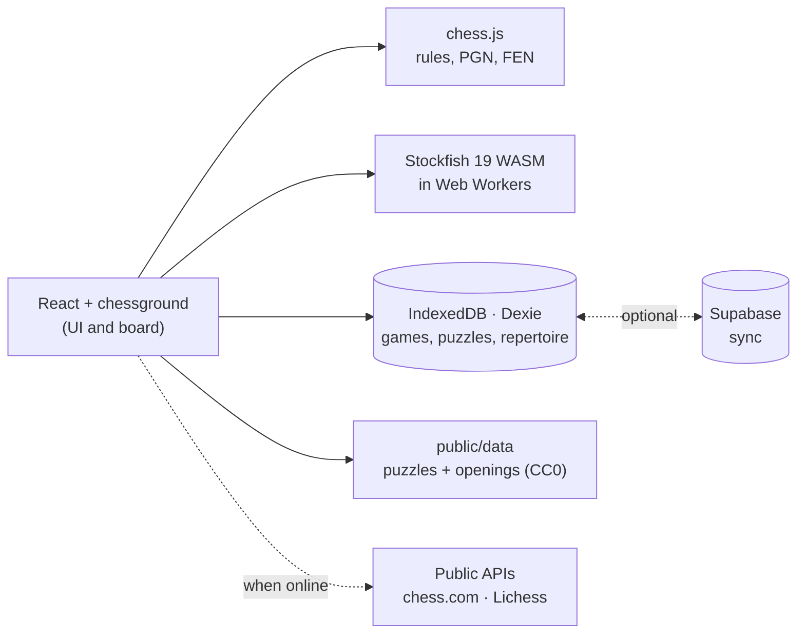

<div align="center">


# Open Chess

### Everything chess.com charges for to train, free and on your own device.

Stockfish game review, 13 bots with personality, 104,000 puzzles, an opening trainer and lessons.<br/>
In the browser or as an Android app. **No ads, no subscription and no account.**

[](https://github.com/jupiutrera/open-chess/releases/latest)
[](LICENSE)
[](https://github.com/jupiutrera/open-chess/stargazers)
[](https://jupiutrera.github.io/open-chess/)


<h3>
  <a href="https://jupiutrera.github.io/open-chess/">▶ Try it now</a> ·
  <a href="https://github.com/jupiutrera/open-chess/releases/latest">📱 Download the APK</a>
</h3>

[Español](README.es.md) · [Features](#-features) · [Screenshots](#-screenshots) · [How it works](#-how-it-works) · [Getting started](#-getting-started) · [Contributing](#-contributing)

<br/>


</div>

<br/>

<table align="center">
  <tr>
    <td align="center"><b>13</b><br/><sub>bots, 250 to 3200</sub></td>
    <td align="center"><b>104,000</b><br/><sub>Lichess puzzles</sub></td>
    <td align="center"><b>3,865</b><br/><sub>named openings</sub></td>
    <td align="center"><b>11</b><br/><sub>interactive lessons</sub></td>
    <td align="center"><b>6</b><br/><sub>languages</sub></td>
    <td align="center"><b>$0</b><br/><sub>forever</sub></td>
  </tr>
</table>

## 💡 Why

On chess.com, the things that actually make you better are paid: unlimited game reviews, unlimited puzzles, lessons and the opening trainer. But the engine doing that work, **Stockfish**, is free software and already runs in any browser, and **Lichess** publishes its puzzles and openings as public domain.

Open Chess puts those pieces together in an app with the chess.com experience you already know. Everything happens on your device: the analysis, the bots and your data. The one thing it doesn't do is play online against other people.

| | chess.com free | **Open Chess** |
|---|:---:|:---:|
| Full game review (brilliants, mistakes, accuracy…) | Limited | ✅ **Unlimited** |
| Puzzles and Puzzle Rush | Limited | ✅ **104,000, no limits** |
| Bot assistance (eval, threats, suggestions, engine) | Limited | ✅ **All of it** |
| Repertoire trainer | Premium | ✅ |
| Lessons | Mostly Premium | ✅ |
| Works offline | ❌ | ✅ |
| Ads | Yes | ❌ **Never** |
| Your data | On their servers | ✅ **On your device** |

<sub>A rough comparison with chess.com's free plan; its limits change over time.</sub>

## ✨ Features

**🔍 Game review.** Stockfish analyses every move and classifies it the way chess.com does: brilliant, great, best, excellent, good, book, inaccuracy, mistake, miss and blunder. You get each player's accuracy, an estimated performance and the evaluation graph. You can see the best move and **retry your mistakes** to learn from them.

**🤖 13 bots with personality.** Pip, the kid who just discovered the knight; Iván, who will sacrifice whatever it takes; Boris, the old-school FIDE master… Each one has a portrait, favourite openings and their own voice: they greet you, react to your captures and blunders, and celebrate (or regret) the result. They play like people, not like a broken engine.

**🎯 Five optional helps.** Evaluation bar, threat arrows, suggestion arrows, live move feedback and engine lines. Turn them on before or during a game.

**🧩 Puzzles.** 104,000 Lichess puzzles with Glicko-2 rating, 47 themes, a daily puzzle, **Puzzle Rush** (3 min, 5 min and survival), **Puzzle Streak** (no clock, each one harder, one miss ends it) and **mistake puzzles** taken from your own reviewed games.

**📖 Openings.** An explorer with 3,865 named openings, masters and Lichess stats, and a **repertoire trainer** with spaced repetition (SM-2).

**🧠 Analysis.** Live Stockfish with up to three lines, move-by-move ratings, a position editor, and FEN and PGN import and export.

**🎓 Lessons.** Tactics, basic mates and endgames that you practise against the engine until they stick.

**📥 Import your games** from chess.com or Lichess by username, or by pasting a PGN.

**🎨 Your way.** 9 piece sets, 5 boards, light, dark or system theme, 5 recorded sound sets, L-shaped knight arrows and haptics on Android.

**🌍 In your language.** Español, English, Français, Italiano, 中文 and 日本語, including the lessons and everything the bots say.

## 📸 Screenshots

<div align="center">


<br/>


</div>

## ⚙️ How it works



<details>
<summary><b>The engine</b></summary>

Stockfish 19 (the single-threaded 1.8 MB *lite* build) runs in a Web Worker, so the UI never blocks. It works the same in the browser and inside the Android WebView, with no server. A small UCI client (`src/engine/engine.ts`) queues searches, cancels stale ones and converts scores to White's point of view. In-game helps use their own worker with a per-position cache, so they never slow the bot down.

</details>

<details>
<summary><b>Move classification</b></summary>

Each position's evaluation becomes a win probability with Lichess's curve:

```
win% = 50 + 50 · (2 / (1 + e^(-0.00368208 · cp)) − 1)
```

A move's quality depends on how much win probability the mover gives up:

| win% lost | Classification |
|---|---|
| engine's move, or < 0.5 | Best |
| < 2 | Excellent |
| < 5 | Good |
| < 10 | Inaccuracy |
| < 20 | Mistake |
| ≥ 20 | Blunder |

Special cases are detected too: **book** (the position is in the opening book), **forced** (only one legal move), **brilliant** (you give up material and the position stays good), **great** (the only move that keeps the advantage) and **miss** (your opponent erred and you didn't take advantage). **Accuracy** uses Lichess's formula. It all lives in `src/features/review/classify.ts`.

</details>

<details>
<summary><b>The bots</b></summary>

From 1400 Elo up, Stockfish's `UCI_Elo` does the work. Below that Stockfish won't go under 1320, so weaker bots search a few candidate moves at low depth and pick one with a temperature softmax and some randomness. They make human mistakes, not broken-engine ones. Each bot has favourite openings, a conversation style and a portrait whose expression follows the game (`src/features/play/`).

</details>

<details>
<summary><b>Puzzles, data and sync</b></summary>

`scripts/build-puzzles.mjs` streams the Lichess puzzle database (about 300 MB of zstd), keeps the popular puzzles and splits them into files per 100-point band that load on demand. The opening book is available offline from the start, and each puzzle band (plus its two neighbours) is cached as soon as you use it, so you keep puzzles at your level without a connection. Your rating uses **Glicko-2**.

Your data lives in IndexedDB. Every row carries `updatedAt` and a soft delete, so the optional Supabase sync is a simple last-write-wins with per-user RLS: the server ignores any write older than the one it holds, and changes are pulled by a server-side sequence. The device's modification time wins, so a badly skewed clock can let the wrong change win. Without Supabase configured, nothing is sent anywhere.

</details>

## 🚀 Getting started

You need Node 22 or later.

```bash
git clone https://github.com/jupiutrera/open-chess.git
cd open-chess
npm install          # also copies Stockfish into public/stockfish
npm run dev          # http://localhost:5173
```

| Command | What it does |
|---|---|
| `npm run dev` | Dev server |
| `npm run build` | Production (PWA) build into `dist/` |
| `npm test` | Unit tests: classification, accuracy, Glicko, lessons, translations |
| `npm run e2e` | Browser tests with Playwright |
| `npm run data:puzzles` | Rebuild the puzzles from Lichess |
| `npm run data:openings` | Rebuild the openings from lichess-org/chess-openings |
| `npm run data:avatars` | Generate the bot portraits |
| `npm run data:sounds` | Download and convert the sound sets (needs ffmpeg) |
| `node scripts/screenshots.mjs --gif` | Regenerate this README's screenshots and GIF |

<details>
<summary><b>📱 Android APK</b></summary>

You also need JDK 21 and the Android SDK.

```bash
npm run android                      # web build + sync into the Android project
cd android && ./gradlew assembleDebug
adb install -r app/build/outputs/apk/debug/app-debug.apk
```

For a signed release, create a keystore and point to it from `android/keystore.properties` (git-ignored):

```properties
storeFile=/path/to/open-chess.jks
storePassword=…
keyAlias=open-chess
keyPassword=…
```

then run `./gradlew assembleRelease`. Back the keystore up: if it's lost, nobody can update the installed app. Pushing a `v*` tag runs `android-release.yml`, which builds the signed APK and attaches it to the release; it needs the `ANDROID_KEYSTORE_BASE64`, `ANDROID_KEYSTORE_PASSWORD`, `ANDROID_KEY_ALIAS` and `ANDROID_KEY_PASSWORD` secrets.

</details>

<details>
<summary><b>🔄 Sync across devices (Supabase)</b></summary>

1. Create a free project at [supabase.com](https://supabase.com).
2. Run the migrations in [`supabase/migrations/`](supabase/migrations/) in order in the SQL editor. If you already used sync, run only the new ones.
3. Under *Authentication*, enable Email (magic link) and optionally Google. Add the app URL to *Redirect URLs*.
4. Copy `.env.example` to `.env` and fill in `VITE_SUPABASE_URL` and `VITE_SUPABASE_ANON_KEY`.

</details>

<details>
<summary><b>📊 Lichess explorer stats</b></summary>

The Lichess opening explorer API needs a personal token. Create one with no scopes at <https://lichess.org/account/oauth/token> and paste it in **Settings**. Without a token the explorer still works from the local opening book.

</details>

<details>
<summary><b>🗂️ Code layout</b></summary>

```
src/
  engine/      Stockfish UCI client
  chess/       helpers, sounds, clock, game state
  board/       board, eval bar, move list, result marks
  features/
    play/      bots, portraits, chat, helps, games
    review/    analysis, classification, accuracy, review UI
    puzzles/   data, Glicko-2, puzzles, Rush
    openings/  book, explorer, repertoire (SM-2)
    lessons/   lessons and player
    analysis/  analysis board and editor
    import/    chess.com, Lichess, PGN
    profile/   profile, games, settings
  db/          Dexie (IndexedDB)
  sync/        Supabase and backups
  i18n/        6 languages + lesson and bot translations
android/       Capacitor project
scripts/       data, portraits, sounds and screenshots
```

</details>

## 🤝 Contributing

Contributions are welcome: new lessons, more bots, **translations into other languages**, better classification… Read [CONTRIBUTING.md](CONTRIBUTING.md) before opening a PR.

- Lessons are data in `src/features/lessons/lessonData.ts`, and a test checks that every move in them is legal.
- To add a language, copy `src/i18n/en.json` and `src/i18n/content/fr.json` and register it as CONTRIBUTING describes. A test checks that no key is missing.

## 📜 Credits and licences

Open Chess is **GPL-3.0-or-later** and builds on:

| Resource | Author | Licence |
|---|---|---|
| [Stockfish](https://stockfishchess.org) / [stockfish.js](https://github.com/nmrugg/stockfish.js) | Stockfish team, Nathan Rugg | GPL-3.0 |
| [chessground](https://github.com/lichess-org/chessground) | Lichess | GPL-3.0 |
| [chess.js](https://github.com/jhlywa/chess.js) | Jeff Hlywa | BSD-2 |
| [Puzzle database](https://database.lichess.org/#puzzles) and [chess-openings](https://github.com/lichess-org/chess-openings) | Lichess | CC0 |
| Staunty, Fresca, Tatiana, Maestro, Cardinal, Gioco pieces | sadsnake1 | CC BY-NC-SA 4.0 |
| California pieces | Jerry S. | CC BY-NC-SA 4.0 |
| Chessnut pieces | Alexis Luengas | Apache-2.0 |
| cburnett pieces | Colin M.L. Burnett | GPL-2.0+ |
| Bot portraits, [Open Peeps](https://www.dicebear.com/styles/open-peeps/) style via [DiceBear](https://www.dicebear.com) | Pablo Stanley | CC0 1.0 |
| Stockfish portrait, [Bottts](https://www.dicebear.com/styles/bottts/) style | Pablo Stanley | Free for personal and commercial use |
| "Wood" sounds | [pychess](https://github.com/pychess/pychess) | GPL-3.0 |
| SFX, Piano, NES and Futuristic sounds | Enigmahack, via [Lichess](https://github.com/lichess-org/lila) | AGPL-3.0+ |
| [Fluent Emoji](https://github.com/microsoft/fluentui-emoji) icons | Microsoft | MIT |
| [Phosphor](https://phosphoricons.com) icons | Phosphor | MIT |
| [Geist](https://vercel.com/font) font | Vercel | OFL-1.1 |

> [!NOTE]
> Several piece sets are licensed **non-commercial** (CC BY-NC-SA). Open Chess is and will stay free. If you fork it for commercial use, remove or replace those sets.

Open Chess is not affiliated with chess.com or Lichess.

<div align="center">
<br/>

**If Open Chess saves you a subscription, give the repo a ⭐.**<br/>
<sub>It helps more people find a way to train without paying.</sub>

</div>
