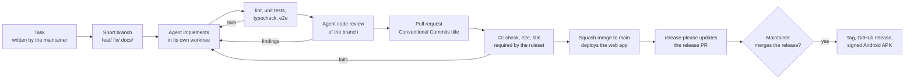

# How Open Chess is built with coding agents

Most of the code in this repository was written by coding agents, directed by one person. This page describes the method: what an agent is given before it writes, what checks its work without taking its word for it, and what stays a human decision.

The rules the agents follow are in [AGENTS.md](../AGENTS.md).

## In numbers

Counted on `main` at v0.9.1 (16 November 2026).

| | |
|---|---|
| First commit | 27 October 2026 |
| Commits on `main` | 204 |
| Commits with a Claude co-author trailer | 155 (the trailer was later dropped by rule, so newer agent commits do not carry it) |
| Merged pull requests | 47 |
| Releases | 16 |
| Application code | about 19,100 lines of TypeScript |
| Tests | about 3,000 lines in 42 unit test files, plus 17 Playwright end-to-end tests |
| Interface languages | 7 |

## The loop for one change

Several changes can be in progress at once: each agent works in its own git worktree, on its own branch, and gets its task in its prompt.

## What an agent reads before it writes

An agent starts every session knowing nothing about the project, so the decisions that should not be made again are written down once:

- **[AGENTS.md](../AGENTS.md)**: the commands, the project rules, the branch and PR workflow, and how versions and releases work.
- **[PRODUCT.md](../PRODUCT.md)**: who the app is for, what it is for and what it will not do.
- **[DESIGN.md](../DESIGN.md)**: the visual system, so that a new screen looks like the others.

AGENTS.md opens with the rule that settles conflicts: if something in it contradicts an old habit in the git history, the file wins. The history contains conventions that were later abandoned, and it is the file, not the history, that says which ones are current.

## Checks that do not depend on the agent's word

An agent reporting that something works is not evidence. These checks are:

| Check | What it catches |
|---|---|
| `src/i18n/i18n.test.ts` | A text added in one language and not the others: every language must have the same keys and the same placeholders as English. |
| `src/features/lessons/lessonData.test.ts` | A lesson with an illegal move, a "mate" that is not mate, or a practice position where the learner lacks the material the goal needs. Lessons are data, so their correctness is tested move by move. |
| `src/features/review/classify.test.ts` | Changes to how moves are classified in the game review. |
| `e2e/smoke.spec.ts` (Playwright) | 17 flows through the real app in a browser: playing a bot and reviewing the game, takebacks while the bot thinks, resuming a game with its clock, exporting a review as a video, every page rendering without errors. |
| `oxlint`, `tsc -b`, `vite build` | The usual. |
| `PR title` workflow | A title that is not a Conventional Commit. The title becomes the commit on `main` and the CHANGELOG line, and the version is computed from it, so nobody edits a version by hand. |

The ruleset on `main` makes three of them binding: there is no direct push, and a pull request merges only with `check`, `e2e` and `title` green.

## What stays a human decision

- **Scope.** No online play between people. It is written down so that no agent proposes it.
- **Identity.** The app follows the conventions of chess apps without copying the names, icons or look of other products.
- **Public steps.** Merging the release PR creates a tag, a GitHub release and an APK that people download. An agent asks before doing it.
- **Other people's infrastructure.** A change to the optional Supabase sync ships its migration, and the user is never asked to run it.

## Small rules that guard against a specific trap

Each of these is a line in AGENTS.md:

- **Tasks go in the prompt.** The local task list is ignored by git, so an agent working in a worktree cannot see it.
- **Worktrees are removed when the work is done.** Each one installs its own `node_modules`.
- **Data scripts run only when that is the task.** They download whole puzzle and opening databases.
- **The version is never edited by hand.** release-please computes it from PR titles, and Android's `versionCode` is derived from it so that it always increases.
- **No letter suffixes in versions.** `0.4.1b` is a prerelease for npm and sorts before `0.4.1`.
- **Published history and tags are not rewritten.**
